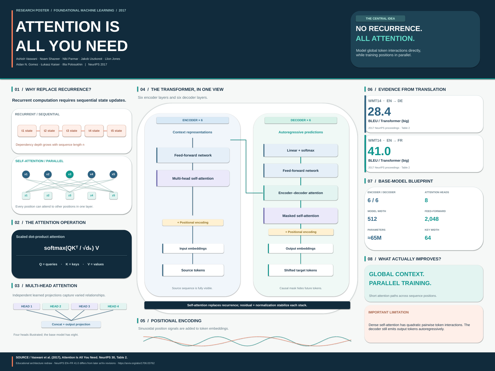

# Research Poster

### From complex papers to clear, verifiable visual arguments.

**An open-source research-poster studio, multi-agent skill, and growing gallery of computer-science papers.**

[Explore the gallery](https://1998x-stack.github.io/Research-Poster/) · [Use the skill](.agents/skills/research-poster/SKILL.md) · [Browse the taxonomy](catalog/taxonomy.json) · [Contribute](CONTRIBUTING.md) · **[简体中文](README.zh-CN.md)**

---

## Research deserves better than a wall of text

A useful research poster is **not a shortened PDF**. It makes one defensible argument at a glance, explains the mechanism in a well-labeled figure, and lets the reader inspect the evidence, assumptions, and limitations.

**Research Poster** turns that editorial practice into a repeatable engineering workflow. It is designed for a **growing collection**, not a single Transformer demonstration: machine learning, computer vision, systems, security, theory, databases, HCI, robotics, and other computing disciplines share one evidence and publishing contract while retaining field-specific visual narratives.

| Research integrity | Editorial design | Reproducible artifacts | Discoverable knowledge |
| :--- | :--- | :--- | :--- |
| Claims traced to an exact paper version, page, table, and protocol | Layout selected to suit the paper—not a single mandatory template | Editable source, SVG, PPTX, printable PDF, preview, metadata | Taxonomy, searchable gallery, individual Pages URLs |
| No invented metrics or misleading comparisons | Diagrams foreground method, results, or proof as appropriate | Automated catalog, asset preflight, and build checks | Add a paper without hand-editing website cards |

## A growing paper gallery

First published example: **Attention Is All You Need** (Vaswani et al., NeurIPS 2017). This is one case study, not the repository's scope. The poster uses the specified NeurIPS proceedings version; its reported WMT14 values should not be silently mixed with later arXiv revisions. [Source and evidence](posters/artificial-intelligence/natural-language-processing/attention-is-all-you-need/evidence.md) · [Editable PPTX / PDF / SVG](posters/artificial-intelligence/natural-language-processing/attention-is-all-you-need/)

New papers are organized in the [computing taxonomy](catalog/taxonomy.json) and appear in the gallery from their own `poster.json` files. An empty subject folder means **reserved category**, not a published poster.

## One workflow, different research stories

| Paper family | Primary visual | Evidence you must preserve |
| --- | --- | --- |
| Deep learning / computer vision | Architecture, training/inference path, ablations | Datasets, splits, baselines, model variant, compute |
| Systems / networks / databases | Topology, hot path, trade-off curve | Hardware/workload, p50/p95/p99, failure modes |
| Algorithms / theory / cryptography | Definition, invariant, proof idea or reduction | Assumptions, theorem scope, asymptotics, threat model |
| HCI / accessibility | Study design, task flow, outcome plots | Participants, protocol, uncertainty, ethics and consent |
| Robotics / embodied AI | Sensor–policy–action loop, real-world setup | Environment, success metric, baselines, safety bounds |
| Interdisciplinary research | Domain process, method, validation | Domain-specific datasets, uncertainty, limitations |

See [paper archetypes](.agents/skills/research-poster/references/paper-archetypes.md), [visual design](.agents/skills/research-poster/references/visual-design.md), and the [editable layout wireframes](.agents/skills/research-poster/assets/templates/). **No layout is required for every paper.**

## Use it with an AI coding agent

The canonical, versioned skill lives at [`.agents/skills/research-poster/SKILL.md`](.agents/skills/research-poster/SKILL.md). Codex, Claude Code, OpenCode, and Pi have thin compatibility entrypoints; they all defer to the same instructions, sources, and quality gates.

**One-prompt workflow** — in a coding agent with this repository checked out:

~~~text
Read AGENTS.md and .agents/skills/research-poster/SKILL.md, including the
references relevant to this paper. Turn <PAPER_URL_OR_LOCAL_PDF> into a
conference-quality research poster. Verify the official source and its
version; build evidence.md; choose a visual narrative appropriate to its
research field; classify it in catalog/taxonomy.json; create a new,
non-destructive paper folder with editable source, poster.svg, poster.pptx,
poster.pdf, preview.png, and poster.json. Run the poster preflight, catalog
validation, tests, and site build; visually inspect print and web outputs.
Clearly report unsupported exports or unverified deployment. Prepare a
reviewable change; do not overwrite existing posters.
~~~

For installation in **another project**, copy the complete `.agents/skills/research-poster/` directory, not just `SKILL.md`; preserve `references/`, `scripts/` and `assets/templates/`. You may also read the skill directly from this repo instead. Tool availability and file-edit permissions depend on your coding agent.

## Quick start

**Requirements:** Python 3.10+ for the metadata/catalog/gallery toolchain; no third-party Python packages for those steps. Rendering PDF/PPTX additionally uses the [optional rendering dependencies](.agents/skills/research-poster/references/dependencies-and-tooling.md).

~~~bash
git clone https://github.com/1998x-stack/Research-Poster.git
cd Research-Poster

# Inspect available primary fields and subfields.
cat catalog/taxonomy.json

# Scaffold a draft; this never overwrites a paper and is not published.
python scripts/new_poster.py \
  --title "Example Research Paper" \
  --category computer-systems --subcategory distributed-systems \
  --year 2026 --venue "Example Conference" \
  --authors "First Author; Second Author" \
  --url "https://example.org/paper"

# Validate and preview the current gallery locally.
python scripts/validate_catalog.py
python -m unittest discover -s tests -v
python scripts/build_site.py --output _site
python -m http.server 8000 --directory _site
~~~

After creating and rendering your own paper:

~~~bash
# Optional rendering environment; LibreOffice and Poppler are OS packages.
python -m pip install -r requirements-render.txt
python scripts/render_posters.py

# Run the independent, portable artifact preflight on any paper directory.
python .agents/skills/research-poster/scripts/preflight.py \
  posters/artificial-intelligence/natural-language-processing/attention-is-all-you-need --strict

python scripts/validate_catalog.py --strict-assets
python scripts/build_site.py --output _site
~~~

`--strict` checks published artifacts and requires `pdfinfo` (Poppler) for a one-page PDF check; it **does not** replace a human print-size and cross-device review. The render pipeline currently supports paper folders containing `make_poster.py`; other authoring sources may need a dedicated renderer. Read [tooling details](.agents/skills/research-poster/references/dependencies-and-tooling.md).

## Architecture

~~~mermaid
flowchart LR
    A["Published paper / DOI / PDF"] --> B["Source & version verification"]
    B --> C["Claim–evidence ledger"]
    C --> D["Domain-specific narrative + layout"]
    D --> E["Editable source + poster outputs"]
    E --> F["Artifact preflight + human QA"]
    F --> G["poster.json + taxonomy"]
    G --> H["Static catalog + GitHub Pages"]
    F -->|issues| D
~~~

~~~text
.agents/skills/research-poster/
├── SKILL.md                      # canonical agent contract
├── references/                   # research, design, domain, QA, tooling, publishing
├── assets/
│   ├── poster.json.template      # metadata example
│   ├── poster-brief.template.md  # legacy brief
│   └── templates/                # claim ledger, review checklist, SVG wireframes
├── requirements.txt              # optional, portable Python render dependencies
└── scripts/preflight.py          # standalone stdlib-based artifact QA
.codex/ .claude/ .opencode/ .pi/   # thin entrypoints; one source of truth
AGENTS.md                         # repo-wide agent engineering and safety rules
catalog/taxonomy.json             # primary field / subfield IDs
posters/<field>/<subfield>/<slug>/
├── evidence.md                   # versioned claim & citation ledger
├── brief.md                      # design and narrative plan
├── poster.json                   # validated gallery metadata
├── make_poster.py                # optional reproducible authoring source
└── poster.svg / poster.pptx / poster.pdf / preview.png
scripts/                          # repository-specific scaffold, render, validate, build
tests/                            # regression tests
site/                             # dependency-light static website
.github/workflows/                # CI and Pages build / deployment
~~~

## Definition of done

A poster is publishable only when its paper identity and version are verified, its claims are traceable, its figures are technically faithful, its limitations are visible, and its web and print assets can be opened and inspected. A passing script is **necessary but not sufficient**.

- **Science:** match each metric to a source version, dataset, protocol and baseline; include limitations and attribution.
- **Design:** inspect poster at physical print scale and at gallery-thumbnail scale; no clipped text, tiny labels or misleading visual encodings.
- **Engineering:** keep authoring source and exported assets together; validate metadata, links, archive formats and build output.
- **Publishing:** only `status: published` enters the gallery; PRs must be reviewable and must not silently modify unrelated papers.

Full gates: [SKILL.md](.agents/skills/research-poster/SKILL.md) · [quality checklist](.agents/skills/research-poster/assets/templates/review-checklist.md) · [contribution guide](CONTRIBUTING.md).

## GitHub Pages and project status

GitHub Actions rebuilds the index from `poster.json` records; no manual card registry. The publishing workflow also renders known Python-backed posters. To enable deployment, select **Settings → Pages → Build and deployment → GitHub Actions** and inspect the deployment run. The intended gallery URL is [1998x-stack.github.io/Research-Poster](https://1998x-stack.github.io/Research-Poster/); the presence of a workflow or a badge alone does not prove that the public site is live.

## Attribution and license

Repository code, original templates and original layouts are provided under [MIT](LICENSE). **Original research remains the intellectual property of its authors and publishers.** Poster interpretations must cite their sources; do not redistribute a publisher PDF, copyrighted diagram, private draft or unlicensed figure merely because it is available online.

This is an evolving research-poster collection. **Transformer is the first example—not the destination.**
