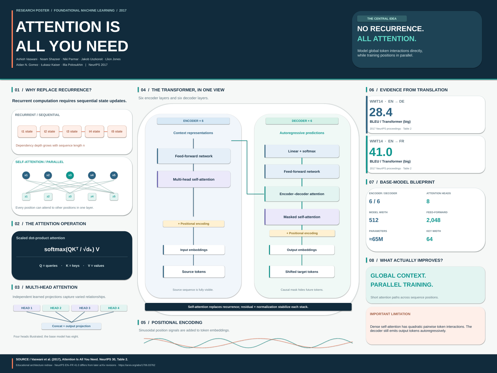

# Research Poster

### 从复杂论文到清晰、可核验的学术视觉论证

**开源学术海报工作室 · 跨 Agent Skill · 持续增长的计算机科学论文画廊**

[浏览海报画廊](https://1998x-stack.github.io/Research-Poster/) · [Research Poster Skill](.agents/skills/research-poster/SKILL.md) · [计算机科学分类](catalog/taxonomy.json) · [English](README.md)

---

## 项目定位

Research Poster 不是 Transformer 海报的专用仓库，而是**可长期扩充的计算机科学研究海报知识库与可复现生产工具链**。将论文转化为会议海报，并非缩短摘要，而是提炼一个有证据支撑的研究主张，以清楚的视觉层级展示核心方法、实验结果与局限。

| 核心能力 | 交付标准 |
| --- | --- |
| 可靠科研证据 | 官方来源、版本、章节/表格、实验设置、基线和局限可追溯 |
| 领域适配设计 | AI/视觉、系统、算法理论、安全、HCI、机器人采用不同的图形叙事 |
| 可编辑与可复现 | 生成源、SVG、PowerPoint、可打印 PDF 和缩略图 |
| 多 Agent 共享 Skill | Codex、Claude Code、OpenCode、Pi 统一读取规范 |
| 动态论文画廊 | 元数据驱动分类、搜索、独立论文页与 GitHub Pages 发布 |

## 海报画廊：从首篇论文开始

**首篇案例：** [Attention Is All You Need](posters/artificial-intelligence/natural-language-processing/attention-is-all-you-need/)（Vaswani 等，NeurIPS 2017）。它展示了整个制作流程，并不限定后续收录内容。当前案例依据 NeurIPS 2017 论文版本；与后续 arXiv 修订版本存在差异的数据必须独立说明。[查看证据记录](posters/artificial-intelligence/natural-language-processing/attention-is-all-you-need/evidence.md)。

后续将持续纳入机器学习、计算机视觉、分布式系统、数据库、网络、安全、算法理论、软件工程、人机交互、机器人及交叉计算研究。目录分类以 [`catalog/taxonomy.json`](catalog/taxonomy.json) 为准；空分类目录是预留位置，不表示已有海报。

## 针对不同论文使用不同海报范式

| 论文类型 | 重点视觉 | 必须记录的验证信息 |
| --- | --- | --- |
| AI / ML / CV | 网络结构、训练/推理路径、消融实验 | 数据集、模型变体、基线、算力、指标 |
| 系统 / 网络 / 数据库 | 系统拓扑、关键路径、性能与权衡 | 负载、硬件、延迟分位数、故障条件 |
| 算法 / 理论 / 密码学 | 不变量、证明直觉、归约、复杂度 | 前提、定理边界、复杂度条件、威胁模型 |
| HCI / 无障碍 | 用户研究流程、任务、结果与置信度 | 样本、协议、不确定性、伦理 |
| 机器人 | 感知—策略—执行闭环 | 环境、成功率口径、安全边界 |
| 交叉研究 | 领域任务—计算方法—验证结果 | 领域数据、外推边界、局限性 |

具体参见 [各类论文的设计指南](.agents/skills/research-poster/references/paper-archetypes.md) 和 [版式模板](.agents/skills/research-poster/assets/templates/)。

## 一段 Prompt 生成下一篇海报

在已经检出本仓库的 Coding Agent 中粘贴：

~~~text
阅读 AGENTS.md、.agents/skills/research-poster/SKILL.md 及其相关 references。
将 <论文 URL 或本地 PDF> 制作成可复现的专业学术会议海报。
先核验官方论文、作者、会议和具体版本；建立 evidence.md，记录
每个重要主张的页码、表格、实验条件与限制；根据研究领域选择
恰当的叙事与版式，不要机械套用 Transformer 风格；在
catalog/taxonomy.json 中选定分类，新建独立论文目录，输出
编辑源、SVG、PPTX、PDF、PNG 和 poster.json。
运行独立海报预检、分类校验、单元测试与静态网站构建，检查
打印可读性和网页展示效果。不得虚构数据、覆盖已有海报或在
未验证部署时声称网站已上线。提交可审查的改动。
~~~

该 Skill 可以拷贝到其他项目使用，**需要整体复制** `.agents/skills/research-poster/`，包括 `references/`、`assets/templates/`、`scripts/` 与 `requirements.txt`，不能只复制入口文件。仓库根目录的 `scripts/` 则负责本知识库自己的数据和网站构建。

## 本地快速开始

**基础环境：** Python 3.10+；分类、元数据、静态站点工具仅使用标准库。

~~~bash
git clone https://github.com/1998x-stack/Research-Poster.git
cd Research-Poster

# 查看现有学科和细分方向
cat catalog/taxonomy.json

# 为一篇论文创建不会覆盖已有内容的草稿
python scripts/new_poster.py \
  --title "Example Research Paper" \
  --category computer-systems --subcategory distributed-systems \
  --year 2026 --venue "Example Conference" \
  --authors "First Author; Second Author" \
  --url "https://example.org/paper"

# 校验、测试、本地网站预览
python scripts/validate_catalog.py
python -m unittest discover -s tests -v
python scripts/build_site.py --output _site
python -m http.server 8000 --directory _site
~~~

需要生成可编辑 PPTX、PDF、PNG 时，再安装可选 Python 依赖及系统级 LibreOffice / Poppler：

~~~bash
python -m pip install -r requirements-render.txt
python scripts/render_posters.py

python .agents/skills/research-poster/scripts/preflight.py \
  posters/artificial-intelligence/natural-language-processing/attention-is-all-you-need --strict
python scripts/validate_catalog.py --strict-assets
~~~

`--strict` 模式需要 Poppler 的 `pdfinfo` 验证单页 PDF；程序检查不等于打印尺寸与排版的人工目视审核。详见 [依赖与工具说明](.agents/skills/research-poster/references/dependencies-and-tooling.md)。

## 架构

~~~mermaid
flowchart LR
    A["论文 / DOI / PDF"] --> B["官方来源与版本核验"]
    B --> C["主张—证据清单"]
    C --> D["领域适配的研究叙事"]
    D --> E["可编辑源 + SVG/PPTX/PDF/PNG"]
    E --> F["自动预检 + 人工审核"]
    F --> G["poster.json + 学科分类"]
    G --> H["搜索索引 + GitHub Pages"]
    F -->|不合格| D
~~~

核心目录：

~~~text
.agents/skills/research-poster/
  SKILL.md                   标准 Skill 入口
  references/                科研、设计、领域策略、工程与 QA
  assets/templates/          证据清单、版式线框、审核模板
  requirements.txt           可选且可移植的渲染依赖
  scripts/preflight.py       独立海报预检
.codex/ .claude/ .opencode/ .pi/
  skills/research-poster/    各 Agent 的薄兼容入口
AGENTS.md                    全仓库的 Agent 协作、校验和安全规则
catalog/taxonomy.json        学科与子领域分类依据
posters/<领域>/<子领域>/<论文 slug>/
  evidence.md / brief.md / poster.json
  poster.svg / poster.pptx / poster.pdf / preview.png
scripts/                      仓库专有的创建、渲染、验证、建站工具
site/                         GitHub Pages 前端
tests/                        自动化回归测试
~~~

## 质量与发布标准

**科研正确性优先于视觉美观。** 所有数字都要对应明确论文版本和实验条件；不能靠夸张比例、裁剪坐标轴制造结果。所有技术图必须保留关键语义，实验与限制并列呈现，且保留独立可编辑源。

正式发布前，需要完成 [审核清单](.agents/skills/research-poster/assets/templates/review-checklist.md)、[元数据校验](scripts/validate_catalog.py)、[产物预检](.agents/skills/research-poster/scripts/preflight.py)、PDF 打印检查以及网页桌面/移动端浏览检查。草稿 `status: draft` 不进入公开索引，`status: published` 才会参与生成。

GitHub Actions 负责画廊构建和发布。首次使用时进入 **Settings → Pages → Build and deployment → Source: GitHub Actions**，并检查实际部署结果。预期地址为 [GitHub Pages 画廊](https://1998x-stack.github.io/Research-Poster/)；工作流存在不代表网站已成功上线。

## 版权与贡献

欢迎为计算机科学各研究方向贡献海报。请阅读 [CONTRIBUTING.md](CONTRIBUTING.md) 与 [AGENTS.md](AGENTS.md)。仓库原创代码、版式和模板采用 [MIT License](LICENSE)，但原始论文、图像和第三方材料仍归原权利人所有。不得默认重新发布受限论文 PDF、未公开稿件或没有授权的图表。

**Attention Is All You Need 是第一张样例，而不是这个项目的终点。**
